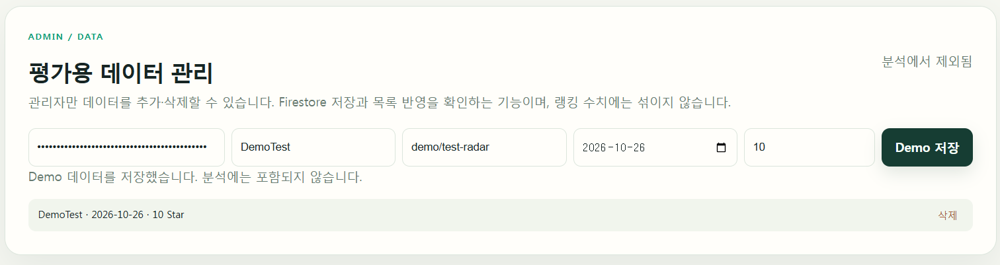
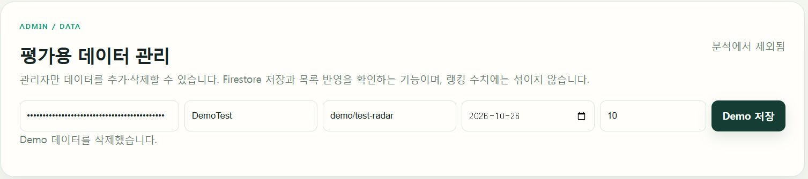

# 배포 및 제출 최종 점검

> 기준: 2026-10-28 운영 점검. 아래의 확인은 이 날짜의 결과이며, 장기 가용성 보증은 아닙니다.

## 확인 완료

- [x] 공개 [Frontend](https://ai-assi-for-me-frontend.vercel.app/)에서 랭킹 5개 표시, Dify 상세 차트·Snapshot, Dify–Ollama 비교 표시 확인
- [x] [Backend `/health`](https://ai-assi-for-me.onrender.com/health) 200, [Swagger UI](https://ai-assi-for-me.onrender.com/docs) 200
- [x] `/api/data/summary?technology=Dify&period=13w` 200: 주당 평균 785.538…, Momentum -14.054…%, `slowing`
- [x] 운영 임시 세션 Chat 답변·대화 저장/불러오기 확인(이전 점검에서 테스트 대화 삭제)
- [x] 390px 모바일 뷰에서 랭킹·비교·관리자 입력·Chat 영역 접근 및 Dify–Ollama 비교 결과 표시
- [x] 사용자 제공 운영 화면 캡처에서 `DemoTest` 저장 성공 문구·목록 반영, 삭제 성공 문구·목록 제거 확인
- [x] `analytics_snapshots/current` 원격 문서 존재, 운영 로그에서 첫 스냅샷 읽기 추정 1건과 후속 랭킹·요약의 추가 읽기 로그 없음
- [x] 로컬 자동 테스트 24개 통과: 분석·Firestore Adapter·API·채팅·권한·할당량 보호·Demo CRUD
- [x] 반응형 수정 후 로컬 320·390·800·1200px에서 관리자 폼·채팅 가로 넘침 점검, 52주 차트 한 줄/모바일 스크롤 확인

## 운영 화면 증빙

아래 이미지는 2026-10-28 사용자가 제공한 배포 화면 캡처다. 관리자 키는 화면에서 마스킹되어 있다. 화면의 저장 성공·목록 반영·삭제 성공을 입증하지만 Firebase Console의 실제 문서나 장기 할당량 사용량을 직접 입증하지는 않는다.

**Demo 저장·목록 반영:** `DemoTest · 2026-10-26 · 10 Star` 행과 저장 성공 문구가 표시된다.

**Demo 삭제:** 삭제 성공 문구가 표시되고 목록에서 테스트 행이 사라졌다.

## 아직 운영에서 확인하지 못한 것

- [ ] Firebase Console에서 `technology_data_manual` 문서의 저장·삭제를 직접 확인하는 단계. 운영 화면의 API 성공과 목록 반영은 확인했지만, 제공된 캡처에 Firebase Console은 포함되지 않았다. 관리자 키는 문서/채팅에 적지 않는다.
- [ ] 다음 정기 주간 동기화의 실제 증분 저장 수와 Firebase 사용량 전후 비교. 코드와 테스트만으로 청구 읽기 수를 확정할 수 없다.
- [ ] 실기기 모바일 터치·키보드 테스트. 390px 브라우저 뷰포트 검증만 완료했다.

## 비용·운영 주의

공개 랭킹·요약·비교·Chat은 저장된 분석 스냅샷을 재사용한다. 스냅샷이 없으면 원본 전체를 자동 스캔하지 않고 `503 ANALYTICS_NOT_READY`를 반환한다. 동기화는 이전 완료 주 이후 행만 저장하고 새 행이 없으면 분석 재계산을 생략한다. 단, 전체 데이터 목록·Export·상세 원본 조회와 최초 적재는 Firestore 읽기/쓰기를 많이 사용할 수 있다. Render의 읽기 추정 로그는 Firebase의 실제 청구량과 다를 수 있다.

다음 월요일 11:00 KST 정기 실행 뒤 GitHub Actions 결과, Render의 `github_sync`/`firestore_read` 로그, Firebase 사용량 그래프를 한 번 대조한다. 반복 새로고침이나 수동 전체 동기화로 점검하지 않는다.

시연 순서는 [DEMO_SCENARIO.md](DEMO_SCENARIO.md)를 참고한다.
