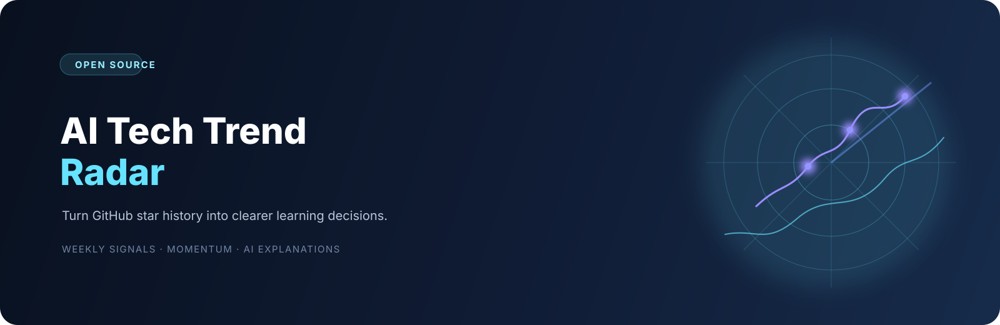
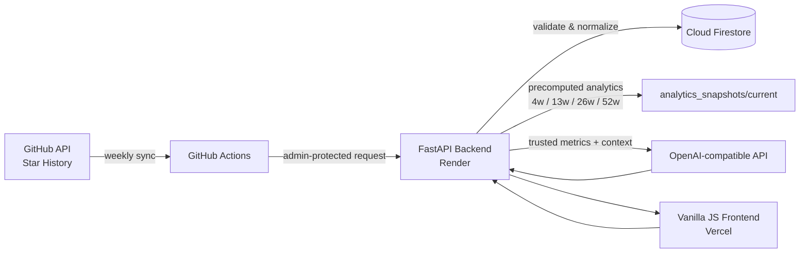

<div align="center">



# AI Tech Trend Radar

**GitHub Star History를 읽어, 지금 학습하고 실험할 가치가 있는 AI 기술을 발견하는 개인용 트렌드 레이더**

[Live Demo](https://ai-assi-for-me-frontend.vercel.app/) · [API Docs](https://ai-assi-for-me.onrender.com/docs) · [Setup Guide](./docs/SETUP.md)

</div>

> 이 프로젝트의 지표는 금융 투자 조언이 아닙니다. 오픈소스 기술에 대한 관심의 흐름을 학습·업무 리소스 배분을 위한 참고 신호로 보여줍니다.

## 프로젝트 소개

AI 생태계는 빠르게 커지고 있지만, 무엇을 먼저 읽고 만들어볼지는 여전히 어렵습니다. AI Tech Trend Radar는 GitHub의 주별 Star 변화를 수집하고, 진행 중인 주를 제외한 완결 데이터만 분석해 기술의 관심 흐름을 한 화면에 보여줍니다.

단순히 누적 Star가 많은 프로젝트를 나열하는 대신, 최근 기간의 주당 평균 신규 Star와 직전 동일 기간의 변화를 함께 봅니다. 덕분에 “지금 관심이 커지고 있는가?”, “최근 속도가 둔화됐는가?”를 비교 가능한 형태로 확인할 수 있습니다.

## 주요 기능

- **Top 5 Radar** — 4주·13주·26주·52주 기간별 주간 신규 Star와 Momentum으로 상위 기술을 확인
- **기술 상세 분석** — 주별 시계열 차트, 누적 Star Snapshot, 상태 요약 제공
- **기술 비교** — 두 기술의 최근 흐름과 변화율을 나란히 비교
- **Export** — 분석 결과를 JSON·CSV로 내려받아 추가 분석에 활용
- **근거 기반 AI Chat** — Backend가 계산한 분석 결과를 바탕으로 자연어 질문에 응답
- **주간 자동 동기화** — GitHub Actions가 보호된 동기화 API를 호출해 데이터 갱신
- **읽기 절약 구조** — 공개 분석은 미리 계산한 snapshot과 10분 캐시를 우선 사용

## Live Demo

| 화면 | 링크 |
| --- | --- |
| Radar 홈페이지 | [ai-assi-for-me-frontend.vercel.app](https://ai-assi-for-me-frontend.vercel.app/) |
| Backend health | [/health](https://ai-assi-for-me.onrender.com/health) |
| OpenAPI 문서 | [/docs](https://ai-assi-for-me.onrender.com/docs) |
| JSON Export | [weekly_new_stars JSON](https://ai-assi-for-me.onrender.com/api/export/json?metric=weekly_new_stars) |

> Render 무료 인스턴스가 절전 상태라면 첫 요청에 지연이 있을 수 있습니다. `/health`는 서버 기동 상태를 확인하는 엔드포인트이며 Firestore 데이터 준비 상태까지 보장하지 않습니다.

## 기술 스택

| 영역 | 기술 |
| --- | --- |
| Frontend | HTML, CSS, Vanilla JavaScript, Vercel |
| Backend | Python 3.11+, FastAPI, Uvicorn, Pydantic |
| Data | Firebase Admin SDK, Cloud Firestore |
| AI | OpenAI 호환 API · 결정론적 fallback 설명 |
| Data source | GitHub API · GitHub Star History |
| Automation | GitHub Actions · 주간 동기화 workflow |
| Hosting | Vercel(Frontend) · Render(Backend) |

## 아키텍처



핵심 설계는 **수치 계산과 자연어 설명을 분리**하는 것입니다. Star 수·주당 평균·Momentum·랭킹은 Backend가 계산하고, AI는 검증 가능한 결과를 읽기 쉬운 문장으로 설명합니다. 공개 요청은 원본 전체를 매번 읽지 않고 동기화 시 생성한 분석 snapshot을 우선 사용합니다.

## 분석 규칙

- 분석 지표: `weekly_new_stars`
- 분석 기간: 최근 `4w`, `13w`, `26w`, `52w`와 직전 동일 기간
- Momentum: `(최근 기간 평균 - 직전 기간 평균) / 직전 기간 평균 × 100`
- 진행 중인 주는 제외하고 완결된 주만 사용
- GitHub 행과 수동 Demo 행을 분리하며, 수동 Demo 데이터는 공개 분석에서 제외
- 같은 저장소·주·지표의 재수집은 중복 키로 차단

## 빠른 시작

전체 환경변수, Firestore 연결, 로컬 실행, Render·Vercel 배포 절차는 [docs/SETUP.md](./docs/SETUP.md)에 보존했습니다.

```powershell
py -m venv .venv
.\.venv\Scripts\python.exe -m pip install -r requirements.txt
.\.venv\Scripts\python.exe -m uvicorn backend.main:app --reload --port 8000
```

## 검증 명령

```powershell
.\.venv\Scripts\python.exe -m unittest discover -s tests -v
.\.venv\Scripts\python.exe -m compileall backend
node --check frontend/app.js
node --check frontend/theme.js
```

## 프로젝트 의의

이 프로젝트는 트렌드 차트를 만드는 데서 끝나지 않습니다. 외부 API 수집, 시계열 정규화, idempotent 저장, 읽기 비용을 줄이는 snapshot, 서버 신뢰 경계, 익명 세션 기반 대화 저장, AI와 결정론적 분석의 역할 분리까지 하나의 작동하는 제품 흐름으로 연결했습니다.

<div align="center">

Made for better AI learning decisions · [GitHub Repository](https://github.com/bomigrace-byte/ai-assi-for-me)

</div>
